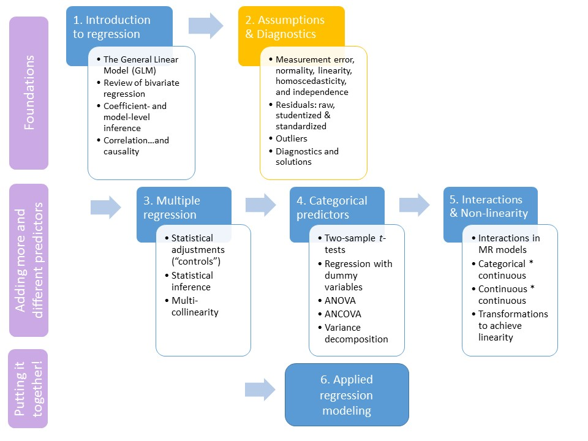
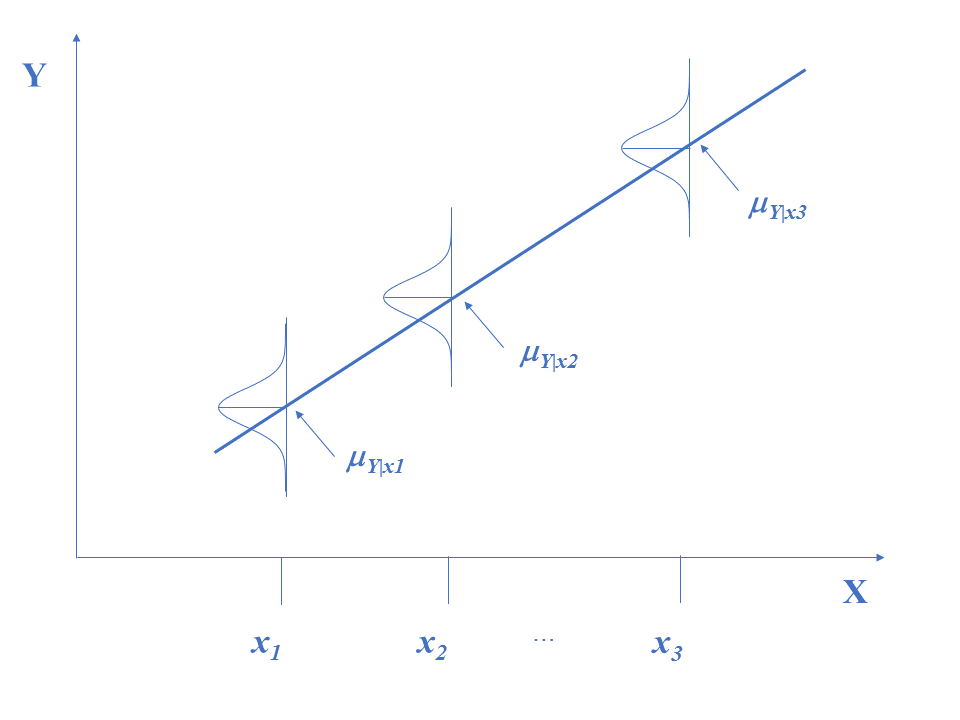

```{R, setup, include = F}
library(pacman)
p_load(here, tidyverse, ggplot2, xaringan, knitr, kableExtra, haven, broom, xaringanthemer, modelsummary)

i_am("slides/EDUC643_5_assumptions.rmd")


red_pink <- "#e64173"
turquoise = "#20B2AA"
orange = "#FFA500"
red = "#fb6107"
blue = "#3b3b9a"
green = "#8bb174"
grey_light = "grey70"
grey_mid = "grey50"
grey_dark = "grey20"
purple = "#6A5ACD"
slate = "#314f4f"

extra_css <- list(
  ".red"   = list(color = "red"),
  ".blue"  =list(color = "blue"),
  ".red-pink" = list(color= "red_pink"),
  ".grey-light" = list(color= "grey_light"),
  ".purple" = list(color = "purple"),
  ".small" = list("font-size" = "90%"))

write_extra_css(css = extra_css, outfile = "my_custom.css")

options(htmltools.dir.version = FALSE)

hook_output <- knit_hooks$get("output")
knit_hooks$set(output = function(x, options) {
  lines <- options$output.lines
  if (is.null(lines)) {
    return(hook_output(x, options))  # pass to default hook
  }
  x <- unlist(strsplit(x, "\n"))
  more <- "..."
  if (length(lines)==1) {        # first n lines
    if (length(x) > lines) {
      # truncate the output, but add ....
      x <- c(head(x, lines), more)
    }
  } else {
    x <- c(more, x[lines], more)
  }
  # paste these lines together
  x <- paste(c(x, ""), collapse = "\n")
  hook_output(x, options)
})

knitr::opts_chunk$set(warning = FALSE,
                      message = FALSE,
                      echo = FALSE,
                      fig.align = "center",
                      fig.height = 6.5,
                      fig.width = 10)

```
# Roadmap

```{r, echo=F, out.width="90%"}

```
---
# A motivating question

### Reminder: 

[Alexandria Stubblebine, Maithreyi Gopalan and Shannon Brady (2024)](https://doi.org/10.1371/journal.pone.0295436) set out to understand who comes to feel like they belong in college, and in particular, how students' personalities are related to their sense of belonging at the end of their first year.


Using real-world data (generously made public by the authors on the [Open Science Framework](https://osf.io/mv6ek/)) from surveys of first-year students at 12 colleges and universities in the U.S. and Canada, we are going to attempt to answer a similar question. 

In particular, we are exploring **the relationship between extraversion** (students' self-reports on the extent to which they are outgoing and sociable, rather than reserved) **and sense of belonging** (students' self-reports on the extent to which they feel they belong and fit in at their college).

```{r}
pb <- read.csv(here("data/belonging.csv")) %>% 
    select(belong = t2__dv_composite__belonging,
           extraversion = t2__dv_composite__personality_extrovert,
           neuroticism = t2__dv_composite__personality_neuroticism,
           school = college_name) %>%
    drop_na()
pb <- rownames_to_column(pb, "id")

```
---
# Bivariate relationship
```{r}
set.seed(643)
lm_plot <- ggplot(pb, aes(x=extraversion, y=belong)) + 
  geom_jitter(alpha=0.2, width=0.1, height=0.05) +
  geom_smooth(method = "lm") +
  xlab("Extraversion") + 
  theme_minimal(base_size = 16)

lm_plot
```

---
# Regression results

(from last unit)
```{r, echo = T}
fit <- lm(belong ~ extraversion, data=pb)
tidy(fit)
```

.small[
- Each 1 unit difference in extraversion (*extraversion*) is associated with a 0.22 unit difference in sense of belonging (*belong*).
 + This represents nearly a quarter of a standard deviation of the outcome (*belong*), or a moderately sized relationship
- Relationship is statistically significant
 + Unlikely that in the population of first-year college students that there is no relationship between extraversion and sense of belonging.
- There is still a lot of residual variation
]

--

.blue[**Have we accurately characterized this relationship???**]

---
# Goals of the unit

- Articulate the assumptions of the General Linear Model broadly and least squares estimation and inference particularly
- Describe sources of assumption violation in the regression model including: measurement error, non-linearity, heteroscedasticity, non-normally distributed residuals, correlated errors, and outliers.
- Articulate properties of residuals and describe their centrality in understanding the regression model assumptions
- Conduct diagnostic tests on regression model assumption violations
- Implement a consistent screening protocol to identify regression model assumption violations
- Implement solutions to regression model assumption violations, when appropriate


---
class: middle, inverse

# Regression fundamentals: 
## The remix

---
# Some definitions

When you conduct any kind of statistical analysis, there are four phenomenon you tend to be interested in:
- .red-pink[**the parameter**]: the underlying substantive concept you are seeking to learn about ***in the population***
  + "the effect of the program on the dropout rate", "sense of belonging", etc.
- .red-pink[**the estimand**]: the "true" distribution of the conceptual relationship ***in the population***; identified as a result of our research design
  + "a randomized control trial of the program", "adjusting for demographics", etc.
- .red-pink[**the estimator**]: the method used to obtain an approximation of this quantity ***in the sample***
  + "Ordinary Least Squares regression", "*t*-test", "LASSO", etc.
- .red-pink[**the estimate(s)**]: the value obtained from conducting a particular statistical test ***in a particular sample***
  + "38.1 scale points", "5.5 percentage points", "a log-odds ratio of 2.3", etc


--

If we posit a linear model, we are suggesting that the estimand we are attempting to recover via our analysis will be linear in nature.

---
# OLS is BLUE


When fitting a linear model to data, we are seeking an estimator that will return a .blue[**BLUE**] estimate:
 + .blue[**B**]est
 + .blue[**L**]inear
 + .blue[**U**]nbiased
 + .blue[**E**]stimate
 
--

**If the assumptions of linear regression are met, OLS estimators are always .blue[BLUE].**

---
# Key assumptions of regression

#### In fitting these models, we assume that the relationships are characterized by:
- No measurement error
- Linearity
- Homoscedasticity (or homoskedasticity?)
- Normally distributed residuals 
- Independent errors
- No unduly influential outliers

---
# Key assumptions of regression

At each value of X, there is a distribution of Y. These distributions have a mean $\mu_{Y|X}$ and a variance of $\sigma^2_{Y|X}$

.pull-left[
1. **Measurement error**: Values of X are non-overlapping
2. **Linearity**: The mean of the Y distributions at each value of X $(\mu_{Y|X})$ can be joined together by a straight line
3. **Homoscedasticity**: Variance of each distribution $(\sigma^2_{Y|X})$ is identical
4. **Normality**: At each given value of X, the values of Y are normally distributed
5. **Independence**: Conditional on values of X, the values of Y are independent of each other
]

.pull-right[
```{r}

```
(6. **Outliers** are baked into several of above)
]

--

These assumptions are not about the sample or the original variables, but are about the **individual error terms (residuals) *in the population***.

---
class: middle, inverse

# Regression diagnostics: measurement error

---
# Original estimates

Classical measurement error (our predictor variable is measured imprecisely) will bias our results to zero and increase residual standard error.

```{r, echo=T, highlight.output=c(12,16)}
summary(lm(belong ~ extraversion, data=pb))
```
---
# Addding measurement error

Classical measurement error (our predictor variable is measured imprecisely) will bias our results to zero and increase residual standard error.

```{r, echo=T, highlight.output=c(12,16)}
pb$extraversion_noise <- jitter(pb$extraversion, factor = 5, amount = 1)
summary(lm(belong ~ extraversion_noise, data=pb))
```

---
# Measurement error in $x$

```{r, fig.width = 10, fig.height = 7, overlay.plot = 1, interval=0.8, animation.hook='gifski', eval=T}
library(scales)
set.seed(123)
n<-200
x <- runif(n)
error<-rnorm(n)
y <- x
errorfactor <- c(0:10)/10
for (factor in errorfactor) {
  x0<-x+factor*error
  ols<-lm(y~x0)
  plot(x0, y, col = alpha("#e64173",0.8), pch = 19, xlim = c(-0.5,2), ylim = c(-0.5,2))
  text(x=0,y=2,adj=c(0,1),paste0(  "b_0=",round(ols$coefficients[1],2), "   b_1=",   round(ols$coefficients[2] ,2) ))
  abline(0,1, col="gray", lwd = 3)
  abline(lm(y~x0), col="#e64173", lwd = 3)
}
```

.footnote[h/t Simon Hess ([@simonhhess](https://twitter.com/simonhhess))]

---
# Measurement error in $y$
```{r, fig.width =10, fig.height = 7, animation.hook='gifski', interval=0.8, overlay.plot =1, eval=T}
set.seed(123)
n<-200
x <- runif(n)
error<-rnorm(n)
y <- x 
errorfactor <- c(0:10)/20
for (factor in errorfactor) {
  y0<-y+factor*error
  ols<-lm(y0~x)
  plot(x, y0, col = alpha("#e64173",0.8), pch = 19, xlim = c(-0.5,1.5), ylim = c(-0.5,2.5))
  text(x=0,y=2.5,adj=c(0,1),paste0(  "b_0=",round(ols$coefficients[1],2), "   b_1=",   round(ols$coefficients[2] ,2) ))
  abline(0,1, col="gray", lwd = 3)
  abline(ols, col="#e64173", lwd = 3)
}
```

.footnote[h/t Simon Hess ([@simonhhess](https://twitter.com/simonhhess))]

---
## Addressing measurement error

- Test for presence of measurement error with reliability statistics
- Solve by:
    + Creating factors of underlying constructs
    + Adjusting standard errors post-hoc
    + SEM
    + Get more (better) data
    + Improve research design

#### We'll learn about reliability in EDUC 645 as well as in more advanced courses such as EDLD 667
#### We will also learn about some solutions in 633/634 (SEM) and EDLD 650 and 679 (causal inference)
#### These are generally problems that are solved by design rather than stats

.small[In our worked example, Stubblebine et al. report that their two-item measure of extraversion has a reliability (Cronbach's $\alpha$) of about 0.70 at the end of the first year. So, it is quite likely that measurement error leads us to *understate* the true relationship between extraversion and belonging.]

---
class: middle, inverse

# Regression diagnostics: 

## Residuals as tools to assess linearity, homoscedasticity, normality and independence

---
# Residuals

```{r, echo=F, fig.height=5}
lm_plot
```

Our fitted regression line contains the "predicted" values of *belong* for each value of *extraversion*. But almost all of the "actual" values of *belong* lie off the actual line regression line.
---
# Example: Student #1142

```{r, fig.height=5}
fit <- lm(belong ~ extraversion, data=pb)
pb$predict <- predict(fit)
pb$resid <- residuals(fit)

pb1142 <- filter(pb, id==1142)
set.seed(643)
 resid_c <- ggplot(pb, aes(x = extraversion, y = belong)) + 
   geom_jitter(alpha=0.2, width=0.1, height=0.05) + 
   geom_smooth(method=lm, data=pb) +
   geom_point(aes(x = extraversion, y = predict), data=pb1142, col = "red", alpha=0.3) +
   geom_point(data = pb1142, aes(x = extraversion, y = belong),
                     color = 'red',
                     size = 3) +
   geom_segment(aes(xend = extraversion, yend=predict), col = "red", alpha = 0.8, data= pb1142) +
   annotate('text', label = "#1142", x = 1.07, y = 5.3, hjust = 0, color = "red", size = 5) +
   xlab("Extraversion") +
   theme_minimal(base_size = 16)
resid_c
```


--

.blue[*What can we say about this student's sense of belonging, relative to our prediction?*]


---
# What is a "residual"?

The difference ("vertical distance") between the observed value of the outcome and its predicted value is called the .red-pink[**residual**].

#### Residuals can be substantively and statistically useful:
- Represent individual deviations from average trend
- Tell us about values of the outcome after taking into account ("adjusting for") the predictor
 + In this case, tell us whether students report a higher or lower sense of belonging than predicted, given their extraversion

---
# Raw and studentized residuals

.small[Raw residuals give us information on how far each observed value is from its predicted value *in the original units of the outcome*. It may be valuable to quantify residuals in more standard units.] 

- .red-pink[**Raw residuals**]: Observed minus fitted values:

$$r_{i} = y_{i} - \hat{y_{i}}$$

- .red-pink[**Standardized residuals**]: Can transform raw residuals into standardized units by dividing by the Mean Square Error (estimate of standard deviation of the residuals).<sup>1</sup>

$$stdr_{i} = \frac{r_{i}}{\sqrt{MSE}}$$


- .red-pink[**Studentized residuals**]: Raw residuals come from models that may be influenced by individual data points (esp. in small samples). To avoid this problem, it is helpful to estimate residuals that come from a model based on all data *except the case at hand (i)*. Here, $MSE_{i}$ is based on a regression fit without observation $i$. 

$$stur_{i} = \frac{r_{i}}{\sqrt{MSE_{-(i)}}}$$

.footnote[[1] Technically, this is an oversimplification as we usually calculate standardized and studentized residuals by also accounting for the "leverage" of observation *i* (how much does it influence the regression statistics).]


---
# Residuals as tools

Residuals can be valuable diagnostic tools to assessing the assumptions of the regression model. In addition to serving as mechanisms to test the overall model, they can point to specific observations that may warrant further inspection. This might include:

- Noticing patterns to change your theory about the correct model or functional form to use
- Inspecting particular cases to determine whether they are mis-measured or belong to a different population than the main one of your study
- Improve your research design overall

Our regression assumptions of .red-pink[**homscedasticity, normality**] and .red-pink[**independence**] are all about the residuals. We often say as shorthand for this that the residuals are .red-pink[**independently and identically distributed**]:
$$\varepsilon_i = \text{i.i.d. } N(0, \sigma^2)$$

---
# Recovering residuals in R
```{r, echo=T}
fit <- lm(belong ~ extraversion, data=pb)

# predict asks for the predicted values
pb$predict <- predict(fit)

# residuals asks for the raw residual
pb$resid <- residuals(fit)

# rstandard asks for the standardized residual
pb$std_resid <- rstandard(fit)

# rstudent asks for the studentized residual
pb$stu_resid <- rstudent(fit)
```

We can now treat these residual and predicted values as new variables in our dataset and examine them using all the other univariate and multivariate analysis tools we have.

---
# Examining the residuals

```{r, echo=T}
summary(pb$resid)
sd(pb$resid)
```

- Sample mean of the residuals is *always* exactly zero
- On a scale ranging from 1 to 6, most of our residuals are within about one point of sense of belonging. However, we've done a poor job of predicting belonging for some students (by as much as four points!).


---
# Examining the residuals

- Compare to the raw residuals on the previous slide to the standardized residuals. *How similar are they?*<sup> 1</sup>

```{r, echo=T}
summary(pb$std_resid)
sd(pb$std_resid)
```

- Note the minima and maxima standardized residual values. .blue[*Given a sample of ~4,300 students, what does this make you think?*]


.footnote[[1] Our standardized and studentized residuals have means *close to* zero, but not quite because of "leverage" corrections (see slide 22)
]


---
# Non-linearity

In addition to examining the original scatterplot to detect the presence of non-linearity...

```{r, fig.height=5.5}
set.seed(123)
x <- seq(-100, 100)    
y <- x^3 + rnorm(length(x), 0, 200000)     
quad <- cbind.data.frame(x, y)
ggplot(quad, aes(x, y)) +
  geom_point() +
  geom_smooth(method=lm, se=F) +
  theme_minimal(base_size = 16) +
  theme(axis.title.x = element_blank(), axis.title.y = element_blank(), axis.text.y = element_blank()) 

```
---
# Non-linearity

In addition to examining the original scatterplot to detect the presence of non-linearity...

```{r, fig.height=5.5}
ggplot(quad, aes(x, y)) +
  geom_point() +
  geom_smooth(method=lm, formula= y ~ poly(x,3), se=F) +
  theme_minimal(base_size = 16) +
  theme(axis.title.x = element_blank(), axis.title.y = element_blank(), axis.text.y = element_blank())

```

--

**We can also examine the residuals to detect non-linearity!**

---
## Non-linearity: residuals v. fitted plot

Plotting the residual values against their fitted values can provide informative insights to many of our regression assumptions. 

```{r, fig.height=5}
quadfit <- lm(y ~ x, data=quad)
quad$predict <- predict(quadfit)
quad$resid <- resid(quadfit)

ggplot(quad, aes(x = predict, y = resid)) + 
         geom_point() +
  geom_hline(yintercept = 0, color = "red", linetype="dashed") +
  ylab("Residuals") + xlab("Fitted values") +
  theme_minimal(base_size = 16) +
  theme(axis.text.y = element_blank())
```
---
## Non-linearity: residuals v. fitted plot

Plotting the residual values against their fitted values can provide informative insights to many of our regression assumptions. 

```{r, fig.height=5}
quadfit <- lm(y ~ x, data=quad)
quad$predict <- predict(quadfit)
quad$resid <- resid(quadfit)

ggplot(quad, aes(x = predict, y = resid)) + 
         geom_point() +
  geom_hline(yintercept = 0, color = "red", linetype="dashed") +
  annotate('rect', xmin = -400000, xmax = -5000, ymin = -600000, ymax = -150000, alpha = 0.3, fill = "purple") +
  annotate('rect', xmin = 1000, xmax = 350000, ymin = 230000, ymax = 850000, alpha = 0.3, fill = "purple") +
  ylab("Residuals") + xlab("Fitted values") +
  theme_minimal(base_size = 16) +
  theme(axis.text.y = element_blank())
```
---
## Non-linearity: residuals v. fitted plot

Let's look at this for our estimates of sense of belonging:
```{r, fig.height=5}
ggplot(pb, aes(x = predict, y = resid)) + 
         geom_jitter(alpha=0.2, width=0.01, height=0) +
  geom_hline(yintercept = 0, color = "red", linetype="dashed") +
  ylab("Raw Residuals") + xlab("Fitted values") +
  theme_minimal(base_size = 16)
```

.blue[**What evidence do you observe of linearity or non-linearity in the residuals for our sense of belonging sample?**]

---
## Non-linearity: residuals v. fitted plot

Let's look at this for our estimates of sense of belonging:
```{r, echo=T, fig.height=4.25}
ggplot(pb, aes(x = predict, y = resid)) + 
         geom_jitter(alpha=0.2, width=0.01, height=0) +
  geom_hline(yintercept = 0, color = "red", linetype="dashed") +
  ylab("Raw Residuals") + xlab("Fitted values") +
  theme_minimal(base_size = 16)
```


---
# Heteroscedasticity

**Heteroscedasticity**: when variance of Y conditional on X $(\sigma^2_{Y|X})$ differs as a function of X

```{r, fig.height=5.5}
set.seed(123)
x <- seq(-100, 100)    
y <- x + rnorm(length(x), 0, 100)
het <- cbind.data.frame(x, y)
het <- het %>% mutate(y2 = case_when(x<=-90 ~ y/4 - 200,
                                 x>-90 & x<=-50 ~ y/4 - 100,
                                 x>-50 & x<50 ~ y + 100,
                                 x>=50 ~ 4*y))
ggplot(het, aes(x, y2)) +
  geom_point() +
  geom_smooth(method=lm, se=F) +
  theme_minimal(base_size = 16) +
  theme(axis.title.x = element_blank(), axis.title.y = element_blank())
```
---
# Heteroscedasticity

**Heteroscedasticity**: when variance of Y conditional on X $(\sigma^2_{Y|X})$ differs as a function of X

```{r, fig.height=5.5}
ggplot(het, aes(x, y2)) +
  geom_point() +
  geom_smooth(method=lm, se=F) +
  geom_quantile(quantiles=0.99, col="gray") +
  geom_quantile(quantiles=0.001, col="gray") +
  theme_minimal(base_size = 16) +
  theme(axis.title.x = element_blank(), axis.title.y = element_blank())
```
---
# Residual heterodscedasticity
```{r, fig.height=5}
ggplot(pb, aes(x = predict, y = resid)) + 
         geom_jitter(alpha=0.2, width=0.01, height=0) +
  geom_hline(yintercept = 0, color = "red", linetype="dashed") +
  ylab("Raw Residuals") + xlab("Fitted values") +
  theme_minimal(base_size = 16)


```

.blue[**What evidence do you observe of homoscedasticity or heteroscedastictiy in the residuals for our sense of belonging sample?**]

---
## Solutions to heteroscedasticity

Heteroscedasticity biases our standard errors. The standard deviation of the estimator $\hat{\beta_{1}}$ is inconsistent for the true value of $\sigma^2_{\hat{\beta_{1}}}$ when there is heteroscedasticity. 

If this were the case, the sample-based statistics do not follow a standard normal distribution (i.e., the CLT). This would invalidate our inferencing.

However, we generally can correct for the presence of heteroscedasticity by the computation of .red-pink[**heteroscedasticity-robust standard errors**]. There are several approaches that rely on the variance-covariance matrix of the errors and a good deal of matrix algebra. 

---
# Heteroscedasticity solutions

.small[We won't spend time on these now, but know that if you are concerned about the presence of heteroscedasticity in your data, you will generally want to use heteroscedasticity- robust standard errors (sometimes called sandwich estimators or [Eicker-Huber-White standard errors](https://www.jstor.org/stable/1912934) ). Some R options include `estimatr::lm_robust` or when producing table results via `modelsummary`.]

.small[
```{r, echo=T, highlight.output=c(5)}
modelsummary(fit, 
  stars=T, gof_omit = "Adj.|AIC|BIC|Log|RMSE|^F$",
  coef_rename = c("extraversion" = "Extraversion (1-5)"),
  vcov =  list("iid", "robust"), escape=F)
```
]

---
# Residual normality: boxplot

For the standard errors (and associated inference tests) that we conduct in the regression analysis to be correct, the residuals **must be normally distributed.** Here it makes most sense to use our *studentized residuals*. .blue[**Why?**]

```{r, echo=T, fig.height=3.75}
boxplot(rstudent(fit))
```

--

A number of outliers, all in the negative direction... (means we are *over*-predicting the sense of belonging of these students)

---
# Residual normality: histogram

For the standard errors (and associated inference tests) that we conduct in the regression analysis to be correct, the residuals **must be normally distributed**

```{r, fig.height=4.5}
ggplot(pb, aes(x = resid)) + 
  geom_histogram(binwidth = 0.25) +
  theme_minimal(base_size = 16)

```

--

And this is confirmed in this histogram. .blue[What sort of skew is this distribution exhibiting?]


.small[A "ceiling" at the top of the belonging scale bunches up our positive residuals and leaves a long negative tail. With 4,000+ students, the CLT gives us some comfort about our inference.]


---
## Residual normality: resid v. fitted 

For the standard errors (and associated inference tests) that we conduct in the regression analysis to be correct, the residuals **must be normally distributed**
```{r, echo=F, fig.height=4.5}
ggplot(pb, aes(x = predict, y = stu_resid)) + 
         geom_jitter(alpha=0.2, width=0.01, height=0) +
  geom_hline(yintercept = 0, color = "red", linetype="dashed") +
  ylab("Studentized Residuals") + xlab("Fitted values") +
  theme_minimal(base_size = 16)
```

.blue[What would you be looking for here to assess for **normality**?]

---
# Residual normality: Q-Q plot

.small[For the standard errors (and associated inference tests) that we conduct in the regression analysis to be correct, the residuals **must be normally distributed**. A .red-pink[**quantile-quantile (Q-Q) plot**] compares where observed values in the sample--at specified percentiles of the distribution--fall in relation to where those same percentile values would fall in a normal distribution. A straight line indicates what a precisely normal distribution would look like.]

```{r, echo=T}
qq <- ggplot(pb) + 
        stat_qq(aes(sample=stu_resid)) +
        geom_abline(color=blue)   # by default, slope=1, intercept=0
```

```{r, fig.height=3.25}
qq +
  theme_minimal(base_size = 16)
```

--

.blue[How are we doing?]

---
# Residual independence

If observations (and residuals) are correlated (i.e., there is some feature in our data that makes some observations have correlated outcomes), then our model is mis-specified and we will have biased standard errors.

.small[In our data, the students in our sample attend one of 11 different colleges and universities.]

```{r, fig.height=4.5}
set.seed(643)
lm_plot_school <- ggplot(pb, aes(x=extraversion, y=belong, col=school)) + 
  geom_jitter(alpha=0.5, width=0.1, height=0.05) +
  xlab("Extraversion") +
  theme_minimal(base_size = 16)

lm_plot_school

lm_school <- lm(belong ~ extraversion + as.factor(school), data=pb)
```


---
# Residual independence

```{r, fig.height=3.5}
ggplot(pb, aes(x = school, y = stu_resid, col=school)) + 
         geom_boxplot() +
  stat_summary(fun = mean, geom = "point", shape = 18, size = 4) +
  geom_hline(yintercept = 0, color = "red", linetype="dashed") +
  ylab("Studentized Residuals") + xlab("") +
  theme_minimal(base_size = 16) +
  theme(legend.position = "none")

```

.small[It might seem like we have 4,260 degrees of freedom, but actually there is far less independent variation in our data because one's membership in a particular group (in this case school) informs (some) of one's outcome value. Notice that we systematically over-predict belonging at some schools and under-predict it at others (diamonds show mean residuals). Thus, our na&iuml;ve inference will be incorrect.]

--

**Depending on disciplinary perspective, we can address these concerns through multi-level modeling or standard error adjustment. More on this in EDUC 645 and EDLD 628/629 (HLM)**


---
# Residual independence

.small[We won't spend time here, but if you are concerned about the presence of clusters in your data--*because you are worried it will affect your inference*--consider using cluster-robust standard errors, which inflate standard errors for the *k*<sup>th</sup> regressor by] $\tau_k$ .small[, where] $\tau_k \approx 1 + \rho_{kx} \rho_{\mu}* (\text{avg. cluster size} - 1)$.

.small[
```{r, echo=T}
modelsummary(lm_school,
  stars=T, coef_omit = "school", escape=F,
  gof_omit = "Adj.|AIC|BIC|Log|RMSE|^F$",
  coef_rename = c("extraversion" = "Extraversion (1-5)"),
  vcov =  list("iid", ~ school))
```
]

---
# Outliers

**Broadly defined as highly atypical and/or influential data point(s).**

These could be a result of:
 + Coding (recording) error
 + Accurate observations of a rare case(s)
 + Observation of an individual from a different population
 
--

**We can characterize outliers on three dimensions:**
1. **Leverage**
 + How unusual is the case in the 'X' direction?
2. **Distance**
 + How unusual is the case in the 'Y' direction?
3. **Influence**
 + How much does the relationship (regression coefficient) change in the absence of the case?
 + Influence is roughly Leverage * Distance
 
---
# Outliers

```{r, fig.height=5}
pb2506 <- filter(pb, id==2506)

set.seed(643)
outlier <- ggplot(pb, aes(x = extraversion, y = belong)) + 
    geom_jitter(alpha=0.2, width=0.1, height=0.05) + 
    geom_smooth(method=lm, se=F, data=pb) +
    geom_point(aes(x = extraversion, y = predict), data=pb2506, col = "red", alpha=0.3) +
    geom_point(data = pb2506, aes(x = extraversion, y = belong),
                      color = 'red',
                      size = 3) +
    annotate('text', label = "#2506 (5, 1)", x = 4.5, y = 1.25, color = "red", size = 5) +
    xlab("Extraversion") +
  theme_minimal(base_size = 16)
outlier
```

.blue[*How would you characterize student #2506 on leverage and distance?*]


---
# Outliers

```{r, echo=T, highlight.output=c(4:5)}
pb_out <- filter(pb, id!=2506)
tidy(lm(belong ~ extraversion, data=pb))
tidy(lm(belong ~ extraversion, data=pb_out))
```

--

**Things don't change much in this case!**

---
# Depends on context
```{r, fig.width = 10, fig.height = 6}
set.seed(1234)
# generate the multivariate normal distribution
df<-as.data.frame(MASS::mvrnorm(n=100, mu=c(10,5), Sigma=matrix(c(1, 0.6, 0.6, 1), nrow=2)))


base <- ggplot(df, aes(x = V1, y = V2)) +
  geom_point() +
  geom_smooth(method = "lm", se = F) +
  xlim(7, 15) +
  ylim(2,8.5) +
  theme_minimal() +
  labs(caption = "N = 100")

base
```


---
# Depends on context
```{r,  fig.width = 10, fig.height = 6}
df2 <- df
df2[101,] <- c(14.5, 2.5)

out <-filter(df2, V1>13)

out1 <- ggplot() +
  geom_point(data=df2, aes(x = V1, y = V2)) +
  geom_smooth(data=df2, aes(x = V1, y = V2), method = "lm", se = F) +
  geom_smooth(data=df, aes(x = V1, y = V2), method = "lm", se = F, color="gray") +
  geom_point(data=out, aes(x = V1, y = V2), color="red") +
  xlim(7, 15) +
  ylim(2,8.5) +
  theme_minimal() +
  labs(caption = "N = 100")

out1
```
---
# Depends on context
```{r, fig.width = 10, fig.height = 6}
df3 <-as.data.frame(MASS::mvrnorm(n=10000, mu=c(10,5), Sigma=matrix(c(1, 0.6, 0.6, 1), nrow=2)))

df4 <- df3
df4[10001,] <- c(14.5, 2.5)

out <-filter(df4, V1>14)

out2 <- ggplot() +
  geom_point(data=df4, aes(x = V1, y = V2)) +
  geom_smooth(data=df4, aes(x = V1, y = V2), method = "lm", se = F) +
  geom_smooth(data=df3, aes(x = V1, y = V2), method = "lm", se = F, color="gray") +
  geom_point(data=out, aes(x = V1, y = V2), color="red") +
  xlim(7, 15) +
  ylim(2,8.5) +
  theme_minimal() +
  labs(caption = "N = 10,000")

out2
```

---
# Depends on context
```{r, fig.width = 10, fig.height = 6}

df4[10002,] <- c(14.25, 2.25)
df4[10003,] <- c(14.4, 2.4)
df4[10004,] <- c(14.6, 2.1)

out <-filter(df4, V1>14)

out2 <- ggplot() +
  geom_point(data=df4, aes(x = V1, y = V2)) +
  geom_smooth(data=df4, aes(x = V1, y = V2), method = "lm", se = F) +
  geom_smooth(data=df3, aes(x = V1, y = V2), method = "lm", se = F, color="gray") +
  geom_point(data=out, aes(x = V1, y = V2), color="red") +
  xlim(7, 15) +
  ylim(2,8.5) +
  theme_minimal() +
  labs(caption = "N = 10,000")

out2
```
---
# Outlier best practices

There are various tests and common "rules of thumb" you may hear about to assess each of distance, leverage and influence:
 - Mahalanobis distance, studentized residuals, Cook's distance, etc.
 
.purple[**Our recommendation**]: address outliers substantively rather than with a particular statistic or "rule of thumb." Some recommendations:
- The more data you have, the less relevant outliers are
- Analyze data with/without outliers to see whether results change
- Use outlier identification to identify mis-coded data and/or individuals who are substantively different than the population of interest (e.g, a student who has 24 schools of enrollment in middle school is likely from a fundamentally different population than students who have between 1 and 6 schools)
- Consider processes such as top-coding (aka, "[Winsorizing](https://en.wikipedia.org/wiki/Winsorizing)")
- Do not simply exclude observations because they are above a certain threshold 

---
class: middle, inverse
# Synthesis and wrap-up


---
# Screening steps

1. **Calculate univariate and bivariate descriptive stats**
 - Check max/min and examine for outlying observations
 - Verify the type of variable (factor or numeric?)
 - Verify the observation counts match the expected numbers
2. **Create boxplots, histograms, density and scatter plots**
 - Examine for outliers and floor/ceiling effects
 - Check for linearity, skew, and normality
3. **Test assumptions using residuals**
 - Graph residuals by predicted value. Check for linearity and heteroscedasticity
    + We'll address non-linearity in unit 4
 - Graph residuals by a few other variables to think about independence
 - Plot residual distribution and Q-Q plot to check for normality
 - Do not throw out data simply because it is a set number of SD away from mean
4. **Apply corrections in presence of assumption violations**
 - Generally a good idea to use heteroscedasticity-robust standard errors
 - In clustered settings (schools, facilities, hospitals), generally a good idea to use cluster-robust inference

---
# Putting it all together

.small[
Ordinary Least Squares (OLS) estimators return the Best Linear Unbiased Estimate (.blue[BLUE]) *as long as certain assumptions are met*.
- Before accepting a set of results, examine these assumptions in turn to make sure they are tenable. .purple[**You can't be sure the substantive interpretation of the results is correct until you have evaluated your assumptions!**]
- Residuals can be key tools in evaluating these assumptions

Linear regression models assume that:
- There is no measurement error, the relationship is linear, the variance of Y at each value of X is homoscedastic, residuals are normally distributed, errors are independent and there are no unduly influential outliers.
- Violations of these assumptions mean that either our estimates will be biased, our standard errors will be biased, or both will be.

We can conduct a series of diagnostic steps and (sometimes) corrections to ensure our assumptions are met
- Develop a set of regular best practices that you implement every time prior to fitting models to ensure the basic assumptions of regression are satisfied
- Some assumption violations can be addressed via data management and statistical tools. Others are a feature of our research design that cannot be solved *post-hoc*.
]

---
# Goals of the unit

- Articulate the assumptions of the General Linear Model broadly and least squares estimation and inference particularly
- Describe sources of assumption violation in the regression model including: measurement error, non-linearity, heteroscedasticity, non-normally distributed residuals, correlated errors, and outliers.
- Articulate properties of residuals and describe their centrality in understanding the regression model assumptions
- Conduct diagnostic tests on regression model assumption violations
- Implement a consistent screening protocol to identify regression model assumption violations
- Implement solutions to regression model assumption violations, when appropriate

---
# To-Dos

### Reading: 
- **Finish by Jan. 26**: LSWR Chapter 15.8 - 15.9

### Quiz 1:
- Open now, closes 1/20 at 5p

### Quiz 2: 
- Opens 3:45 Thursday, Jan. 28 (closes 5pm on 1/29)

### Assignment 1:
- Due Feb 1., 11:59pm

### Next week: Multiple regression

--

.red[**Midterm Student Experience Survey!!!**]

 
